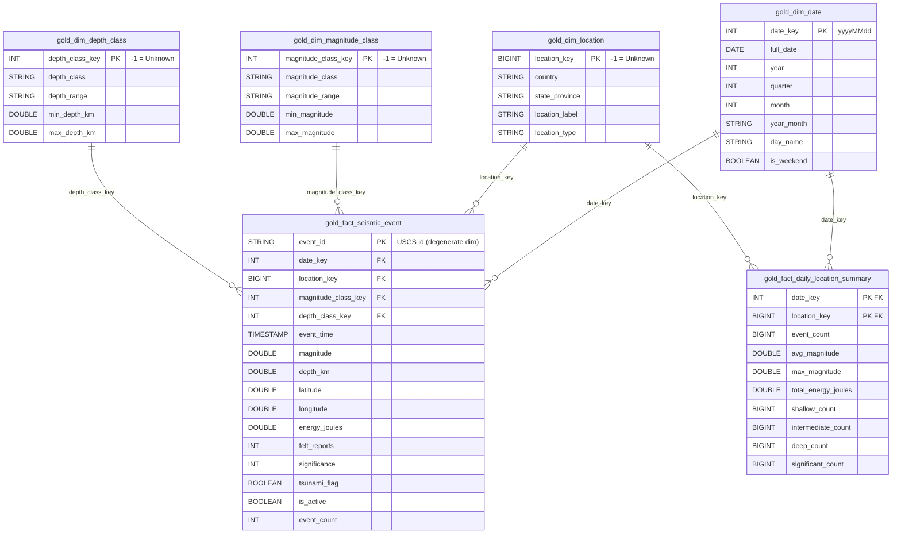

# Gold Layer Data Dictionary — Seismo Star Schema

The Gold layer turns `silver_seismic_events` into a **star schema** designed for Power BI.
It is built by `notebooks/03_Gold_Transformations.py`, tuned by `notebooks/04_Gold_Optimize.py`, and refreshed
automatically at the end of every pipeline run (`notebooks/05_Run_Pipeline.py`).

- **2 fact tables:** `gold_fact_seismic_event` (one row per event) and `gold_fact_daily_location_summary` (pre-aggregated)
- **4 dimension tables:** date, location, magnitude class, depth class
- **3 audit views** for the pipeline-health dashboard page

---

## 1. Entity-Relationship Diagram

> GitHub renders the diagram above automatically. For the PDF report, paste the block into
> [mermaid.live](https://mermaid.live) and export PNG/SVG.

### Relationships (configure exactly these in Power BI → Model view)

| From (many side) | Column | To (one side) | Column | Cardinality | Cross-filter |
|---|---|---|---|---|---|
| `gold_fact_seismic_event` | `date_key` | `gold_dim_date` | `date_key` | Many-to-one (*:1) | Single |
| `gold_fact_seismic_event` | `location_key` | `gold_dim_location` | `location_key` | Many-to-one (*:1) | Single |
| `gold_fact_seismic_event` | `magnitude_class_key` | `gold_dim_magnitude_class` | `magnitude_class_key` | Many-to-one (*:1) | Single |
| `gold_fact_seismic_event` | `depth_class_key` | `gold_dim_depth_class` | `depth_class_key` | Many-to-one (*:1) | Single |
| `gold_fact_daily_location_summary` | `date_key` | `gold_dim_date` | `date_key` | Many-to-one (*:1) | Single |
| `gold_fact_daily_location_summary` | `location_key` | `gold_dim_location` | `location_key` | Many-to-one (*:1) | Single |
| `gold_vw_pipeline_runs` | `date_key` | `gold_dim_date` | `date_key` | Many-to-one (*:1), optional | Single |

Mark `gold_dim_date` as the **date table** (Table tools → Mark as date table → `full_date`).

---

## 2. Design Decisions

| Decision | Choice | Reason |
|---|---|---|
| Schema shape | **Star** (not snowflake) | Every dimension is small and flat; one join hop per filter keeps DAX simple and queries fast. |
| Fact grain | One row per USGS event (current version) | Silver is already SCD Type 1, so the fact mirrors the latest truth. History stays in Bronze (SCD2). |
| Aggregate fact | Day × location | Trend visuals (monthly frequency, energy release, shallow/deep ratio) scan ~100× fewer rows. |
| Surrogate keys | `date_key` = `yyyyMMdd`; location = sequential BIGINT; class dims = small INTs | Integer keys compress well and join fast. Date key is human-readable and sortable. |
| Unknown member | Key `-1` in every dimension | Facts never have NULL foreign keys, so Power BI relationships never drop rows. |
| Class keys from numbers | Gold recomputes magnitude/depth class from the numeric value | Silver's `CASE` sends a NULL magnitude to `Great` and a NULL depth to `Deep`; Gold sends them to `Unknown` instead. |
| Location conformance | `(country, state_province)` grain | Silver `region` keeps "NN km DIR of" text (almost unique per event). Gold maps US state codes/names → `United States` + state, strips direction prefixes and "region" suffixes, and keeps the precise text on the fact as `nearest_place`. |
| Soft deletes | `is_active` flag on the fact; summary counts active events only | Deleted USGS events stay auditable but drop out of KPIs. |
| Energy | `energy_joules = 10^(1.5·M + 4.8)` (Gutenberg–Richter) | Lets BI answer "energy release vs frequency" (Phase 1, Q3). |
| Physical layout | Liquid Clustering `CLUSTER BY (date_key, location_key)` on facts, no partitions | ~15k events/year: Hive partitions by year/month would create many tiny files. Clustering gives file skipping on the BI filter columns without the small-file problem, and keys can be changed later without rewriting the table. |

---

## 3. Refresh Strategy (incremental, idempotent)

| Table | How it is refreshed | Idempotency |
|---|---|---|
| `gold_dim_magnitude_class`, `gold_dim_depth_class` | `MERGE` seed from constants in the notebook | Rows are updated only if a value changed → normally 0 writes |
| `gold_dim_date` | `MERGE` insert-only of every missing day between the earliest and latest event (stays contiguous) | Existing days are never rewritten |
| `gold_dim_location` | `MERGE` insert-only of new `(country, state_province)` members; key = `max(key) + row_number()` | Existing members keep their keys forever |
| `gold_fact_seismic_event` | `MERGE` on `event_id`, reading **only Silver rows with `updated_timestamp >` the Gold watermark** (`max(silver_updated_timestamp)` in the fact) | Re-run with no new Silver data → 0 rows read, all steps logged as `SKIPPED` |
| `gold_fact_daily_location_summary` | Re-aggregate the affected date range (new dates + previous dates of changed events + anything left over by a failed run) and replace it atomically with `replaceWhere` | Same input → same output; no duplicates possible |

`full_refresh = true` ignores the watermark and re-merges every Silver row (use after changing Gold logic).

Every step writes one row to `pipeline_execution_log` with `layer = 'SILVER_TO_GOLD'`,
`source_param = <gold table>`, `records_processed` (rows read or rows aggregated), `records_inserted`,
`records_updated` (from Delta `operationMetrics`) and `execution_duration_sec`. Failures also go to `error_log`
(`error_type = 'GOLD_TRANSFORMATION'`) with the stack trace.

---

## 4. Column Reference

### `gold_fact_seismic_event` — transaction fact (grain: 1 row per event)
Clustered by `date_key, location_key`.

| Column | Type | Key | Description |
|---|---|---|---|
| `event_id` | STRING | **PK** | USGS event id (degenerate dimension) |
| `date_key` | INT | FK → `gold_dim_date` | UTC event date as `yyyyMMdd` |
| `location_key` | BIGINT | FK → `gold_dim_location` | Conformed location; `-1` = Unknown |
| `magnitude_class_key` | INT | FK → `gold_dim_magnitude_class` | From numeric magnitude; `-1` = NULL magnitude |
| `depth_class_key` | INT | FK → `gold_dim_depth_class` | From numeric depth; `-1` = NULL depth |
| `event_time` | TIMESTAMP | | UTC origin time |
| `event_hour_utc` | INT | | 0–23, for time-of-day analysis |
| `magnitude` | DOUBLE | measure | Event magnitude |
| `magnitude_type` | STRING | | `mb`, `ml`, `mww`, ... |
| `depth_km` | DOUBLE | measure | Focal depth |
| `latitude`, `longitude` | DOUBLE | | Epicentre (map visual) |
| `place` | STRING | | Original USGS place text |
| `nearest_place` | STRING | | `place` without the "NN km DIR of" prefix |
| `felt_reports` | INT | measure | "Did You Feel It?" reports |
| `cdi`, `mmi` | DOUBLE | measure | Community / Modified Mercalli intensity |
| `significance` | INT | measure | USGS significance score (0–1000+) |
| `alert_level` | STRING | | PAGER alert (green/yellow/orange/red) |
| `tsunami_flag` | BOOLEAN | | Tsunami advisory issued |
| `status` | STRING | | automatic / reviewed / deleted |
| `event_type` | STRING | | earthquake, quarry blast, explosion, ... |
| `network_code` | STRING | | Contributing seismic network |
| `is_active` | BOOLEAN | | FALSE = soft-deleted by USGS |
| `is_significant` | BOOLEAN | | `significance >= 600` (USGS "significant" threshold) |
| `energy_joules` | DOUBLE | measure | `10^(1.5·M + 4.8)` |
| `energy_tnt_tons` | DOUBLE | measure | `energy_joules / 4.184e9` |
| `event_count` | INT | measure | Always 1 (additive count) |
| `source_batch_id` | STRING | lineage | Bronze/Silver batch that last changed the event |
| `silver_updated_timestamp` | TIMESTAMP | watermark | Silver `updated_timestamp` copied for incremental loads |
| `gold_created_timestamp`, `gold_updated_timestamp` | TIMESTAMP | audit | When Gold first/last wrote the row |

### `gold_fact_daily_location_summary` — aggregate fact (grain: 1 row per day × location)
Only `is_active = true` events. Clustered by `date_key, location_key`.

| Column | Type | Key | Description |
|---|---|---|---|
| `date_key` | INT | **PK**, FK → `gold_dim_date` | |
| `location_key` | BIGINT | **PK**, FK → `gold_dim_location` | |
| `event_count` | BIGINT | measure | Events that day in that location |
| `avg_magnitude`, `max_magnitude`, `min_magnitude` | DOUBLE | measure | |
| `avg_depth_km` | DOUBLE | measure | |
| `total_energy_joules` | DOUBLE | measure | Sum of event energy |
| `shallow_count`, `intermediate_count`, `deep_count` | BIGINT | measure | Events per depth class (shallow/deep ratio, Q2) |
| `strong_plus_count` | BIGINT | measure | Events with magnitude ≥ 5.0 |
| `significant_count` | BIGINT | measure | Events with significance ≥ 600 |
| `tsunami_count` | BIGINT | measure | Events with a tsunami flag |
| `felt_reports_total` | BIGINT | measure | Sum of felt reports |
| `max_significance` | INT | measure | |
| `gold_updated_timestamp` | TIMESTAMP | audit | Last refresh of this row |

> Average-of-averages is wrong in BI: for magnitude averages across days use the event fact, or weight
> `avg_magnitude` by `event_count`.

### `gold_dim_date` (grain: 1 row per calendar day, contiguous)

| Column | Type | Description |
|---|---|---|
| `date_key` | INT **PK** | `yyyyMMdd` |
| `full_date` | DATE | Calendar date (UTC) — use for "Mark as date table" |
| `year`, `quarter`, `month`, `day_of_month`, `day_of_year`, `week_of_year` | INT | Calendar parts |
| `quarter_label` | STRING | `Q1`..`Q4` |
| `month_name`, `month_short` | STRING | `January` / `Jan` (sort by `month`) |
| `year_month` | STRING | `2024-03` (sort by `year_month_key`) |
| `year_month_key` | INT | `202403` |
| `day_of_week` | INT | ISO, 1 = Monday … 7 = Sunday |
| `day_name` | STRING | `Monday` (sort by `day_of_week`) |
| `is_weekend` | BOOLEAN | |

### `gold_dim_location` (grain: 1 row per country × state_province)

| Column | Type | Description |
|---|---|---|
| `location_key` | BIGINT **PK** | Surrogate key; `-1` = Unknown |
| `country` | STRING | Conformed country / territory / oceanic area (e.g. `United States`, `Japan`, `Mid-Atlantic Ridge`) |
| `state_province` | STRING | US state (from `CA`, `Alaska`, ...), otherwise `N/A` |
| `location_label` | STRING | Display text: `California, United States` or `Japan` |
| `location_type` | STRING | `United States`, `Country / Territory`, `Oceanic / Remote`, `Unknown` |
| `created_timestamp`, `updated_timestamp` | TIMESTAMP | Audit |

### `gold_dim_magnitude_class` (static)

| key | magnitude_class | magnitude_range | min (incl.) | max (excl.) | typical_effects |
|---|---|---|---|---|---|
| 1 | Minor | < 3.0 | – | 3.0 | Usually not felt |
| 2 | Light | 3.0-3.9 | 3.0 | 4.0 | Often felt, rarely damaging |
| 3 | Moderate | 4.0-4.9 | 4.0 | 5.0 | Minor damage possible |
| 4 | Strong | 5.0-5.9 | 5.0 | 6.0 | Damage to poor construction |
| 5 | Major | 6.0-6.9 | 6.0 | 7.0 | Destructive within ~100 km |
| 6 | Great | 7.0+ | 7.0 | – | Serious damage over large areas |
| -1 | Unknown | Unknown | – | – | Magnitude not reported |

Columns: `magnitude_class_key` INT PK, `magnitude_class`, `magnitude_range`, `min_magnitude`, `max_magnitude`,
`typical_effects`, `sort_order` (use as "Sort by column" in Power BI).

### `gold_dim_depth_class` (static)

| key | depth_class | depth_range | min km (incl.) | max km (excl.) |
|---|---|---|---|---|
| 1 | Shallow | 0-69 km | – | 70 |
| 2 | Intermediate | 70-299 km | 70 | 300 |
| 3 | Deep | 300+ km | 300 | – |
| -1 | Unknown | Unknown | – | – |

Columns: `depth_class_key` INT PK, `depth_class`, `depth_range`, `min_depth_km`, `max_depth_km`, `description`, `sort_order`.

---

## 5. Audit Views (dashboard "Pipeline Health" page)

| View | Source | Use in BI |
|---|---|---|
| `gold_vw_pipeline_runs` | `pipeline_execution_log` | Runs per layer and status, duration trend, rows processed per run |
| `gold_vw_error_summary` | `error_log` | Errors by layer / type / day, open vs resolved |
| `gold_vw_quarantine_summary` | `silver_seismic_events_quarantine` | Quarantined records by reason and batch |

---

## 6. Business Questions → Gold Objects

| Phase 1 question | Answered by |
|---|---|
| Q1. Which regions show accelerating seismic activity over time? | `gold_fact_daily_location_summary.event_count` by `gold_dim_date.year_month` × `gold_dim_location` |
| Q2. Ratio of shallow (<70 km) to deep (>300 km) events by region? | `shallow_count / deep_count` by `gold_dim_location` |
| Q3. How does energy release correlate with frequency? | `total_energy_joules` vs `event_count` by month |
| Q4. Which regions show increasing magnitude trends? | `avg(magnitude)` from `gold_fact_seismic_event` by year × location |
| KPI cards | `event_count`, `avg/max magnitude`, events in last 30 days (`gold_dim_date.full_date`), distinct `location_key` |
